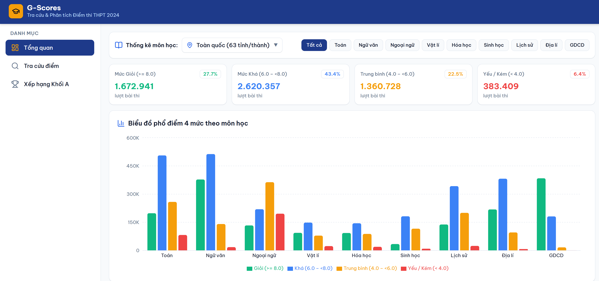
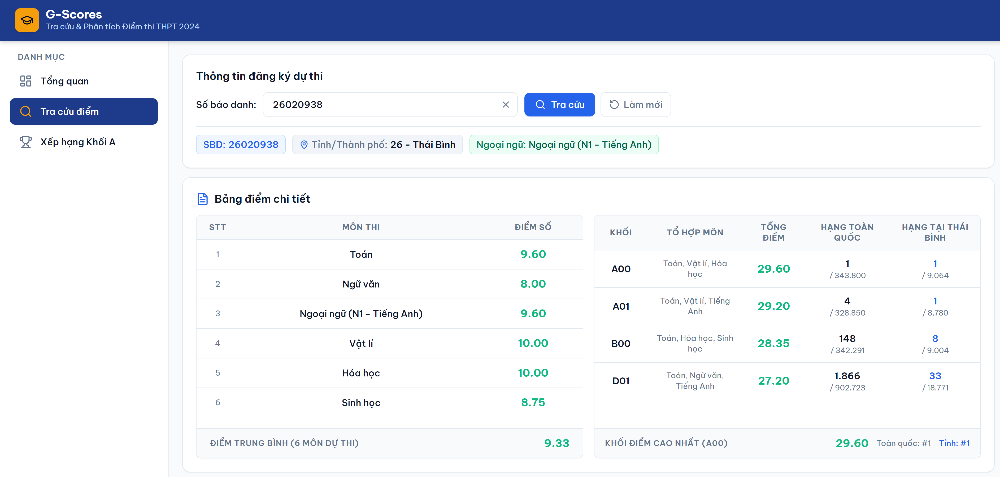
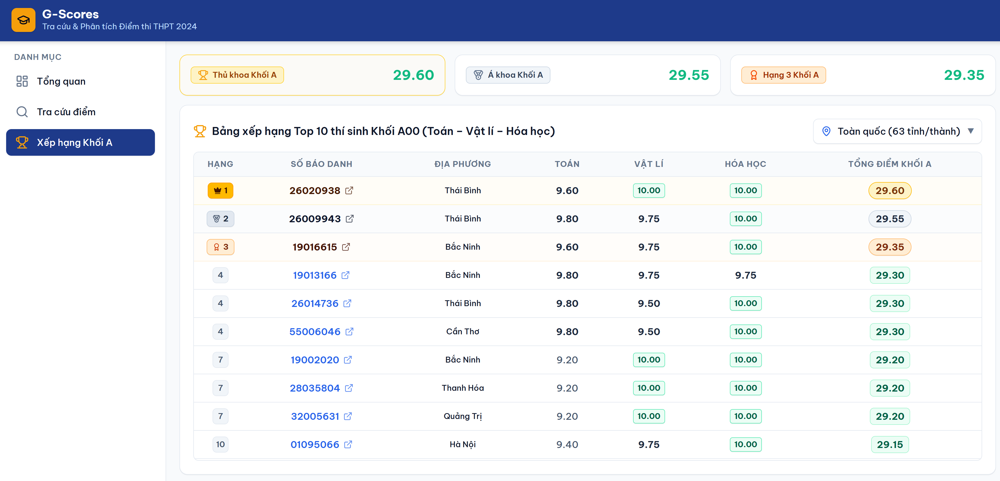
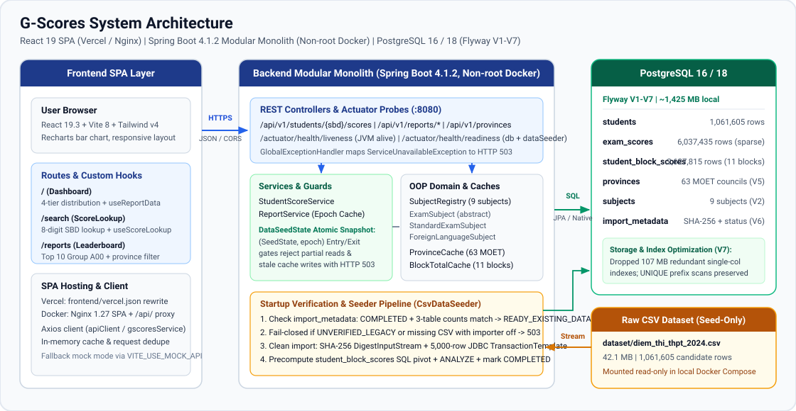

# G-Scores — Vietnam National High School Exam 2024 Platform

G-Scores is a full-stack web application built to ingest, verify, and analyze the **2024 Vietnam National High School Graduation Exam dataset** (`1,061,605` candidates, `6,037,435` subject scores, `2,627,815` precomputed admission block records). The platform supports 8-digit registration number (`SBD`) lookup, nationwide and provincial rankings across **11 college admission blocks** (`A00, A01, B00, C00, D01-D07`), 4-tier score distribution reports across all **63 MOET exam councils**, and Top 10 Group A00 leaderboards.

---

## Live Application & Source Repository

* **Live Web Application (Vercel)**: [https://g-scores-ten.vercel.app/](https://g-scores-ten.vercel.app/)
* **GitHub Repository**: [https://github.com/minh0trang/g-scores](https://github.com/minh0trang/g-scores)

---

## Application Screenshots

### 1. Score Distribution Dashboard (`/`)
4-tier subject score distribution (`>= 8.0`, `6.0 - < 8.0`, `4.0 - < 6.0`, `< 4.0`) with nationwide / provincial filtering and interactive subject selector across all 9 exam subjects.



### 2. Candidate Score Lookup (`/search`)
Validates 8-digit `SBD` across frontend and backend, renders subject scores with polymorphic foreign language display (`N1`-`N7`), and returns precomputed national and provincial rankings for eligible admission blocks.



### 3. Group A00 Top 10 Leaderboard (`/reports`)
Displays the Top 10 Group A00 (`Toán, Vật lí, Hóa học`) candidates nationwide or filtered by province using Competition Rank (`1, 2, 2, 4`) ordered deterministically by `total_score DESC, sbd ASC`.



---

## Tech Stack

| Layer | Technology |
| :--- | :--- |
| **Backend** | Java 17 (Temurin JRE 21 Alpine Docker runtime), Spring Boot `4.1.2`, Spring Web MVC, Spring Data JPA (Hibernate), Bean Validation, Spring Boot Actuator |
| **Database & Migrations** | PostgreSQL `16` (local Docker Compose) / PostgreSQL `18` (production Aiven), Flyway (`V1`–`V7`), JDBC Batch + SQL Pivot |
| **Frontend** | React `19.3`, Vite `8`, Tailwind CSS `v4`, React Router DOM `7`, Recharts `3`, Axios |
| **Infrastructure & Hosting** | Multi-stage Docker (`appuser` non-root + `exec`), Nginx `1.27` Alpine SPA proxy, Docker Compose, Vercel (`vercel.json` SPA rewrite) |

---

## System Architecture

G-Scores follows a **Package-by-Feature Modular Monolith** architecture with strict readiness gates protecting API responses and in-memory caches during startup or dataset verification.



### Repository Structure

```text
g-scores/
├── backend/
│   ├── src/main/java/com/example/backend/
│   │   ├── BackendApplication.java
│   │   ├── common/                 # ApiErrorResponse, BadRequestException, ResourceNotFoundException,
│   │   │                           # ServiceUnavailableException, GlobalExceptionHandler, WebCorsConfig
│   │   ├── importer/               # CsvDataSeeder, CsvRowParser, ImporterProperties, ParsedStudentRow,
│   │   │                           # SeedState, DataSeedState, DataSeederHealthIndicator
│   │   ├── province/               # Province, ProvinceRepository, ProvinceCache, ProvinceController, DTO
│   │   ├── report/                 # ReportController, ReportService, DTOs
│   │   ├── score/                  # ExamScore, ExamScoreRepository
│   │   ├── student/                # Student, StudentBlockScore, Repositories, BlockTotalCache,
│   │   │                           # StudentScoreService, StudentScoreController, DTOs
│   │   └── subject/                # OOP Subject hierarchy: ExamSubject, StandardExamSubject,
│   │                               # ForeignLanguageSubject, LanguageCode, ScoreTier, SubjectRegistry, Entity
│   ├── src/main/resources/
│   │   ├── db/migration/
│   │   │   ├── V1__init_schema.sql
│   │   │   ├── V2__seed_subjects.sql
│   │   │   ├── V3__add_provinces.sql
│   │   │   ├── V4__create_student_block_scores.sql
│   │   │   ├── V5__fix_province_names.sql
│   │   │   ├── V6__create_import_metadata.sql
│   │   │   └── V7__drop_redundant_indexes.sql
│   │   └── application.properties
│   ├── src/test/java/com/example/backend/
│   │   ├── BackendApplicationTests.java
│   │   ├── importer/CsvDataSeederAndHealthTests.java
│   │   ├── report/ReportServiceCacheConcurrencyTests.java
│   │   └── student/StudentScoreServiceReadinessTests.java
│   ├── Dockerfile                  # Maven + JDK 21 build -> non-root Temurin JRE 21 Alpine runtime
│   └── pom.xml                     # Spring Boot 4.1.2, Java 17 target
├── frontend/
│   ├── public/favicon.svg
│   ├── src/
│   │   ├── components/             # BlockScoreTable, GroupALeaderboardTable, MainLayout, ProvinceSelector,
│   │   │                           # SbdSearchForm, ScoreDistributionChart, SubjectScoreTable,
│   │   │                           # SubjectSelectorBar, SubjectTierSummary, TopThreeGroupACards
│   │   ├── hooks/                  # useReportData, useScoreLookup, useIsTouchOrMobile
│   │   ├── pages/                  # Dashboard, ScoreLookup, Leaderboard
│   │   ├── services/               # apiClient, gscoresService, mockData
│   │   ├── App.jsx
│   │   ├── index.css
│   │   └── main.jsx
│   ├── nginx.conf                  # Production SPA routing + /api/ reverse proxy
│   ├── vercel.json                 # Vercel SPA fallback rewrite (/(.*) -> /index.html)
│   └── Dockerfile                  # Node 20 Alpine build -> Nginx 1.27 Alpine runtime
├── dataset/
│   └── diem_thi_thpt_2024.csv      # 2024 exam dataset (1,061,605 rows, ~42.1 MB)
├── imgs/                           # Application screenshots & architecture.svg
├── docker-compose.yml              # PostgreSQL 16 + Spring Boot Backend + Nginx Frontend
└── README.md
```

### Database Schema Evolution (Flyway `V1`–`V7`)
1. **`V1__init_schema.sql`**: Creates normalized tables (`students`, `subjects`, `exam_scores`) with `NUMERIC(4,2)` scores, `CHECK (score >= 0.00 AND score <= 10.00)`, unique constraints, and lookup indexes. Untaken subjects are omitted (**sparse storage**).
2. **`V2__seed_subjects.sql`**: Seeds the 9 official subjects (`TOAN`, `NGU_VAN`, `NGOAI_NGU`, `VAT_LI`, `HOA_HOC`, `SINH_HOC`, `LICH_SU`, `DIA_LI`, `GDCD`).
3. **`V3__add_provinces.sql`**: Creates `provinces`, adds `students.province_code` (2-digit SBD prefix) with FK and index.
4. **`V4__create_student_block_scores.sql`**: Creates `student_block_scores` (`A00`, `A01`, `B00`, `C00`, `D01`–`D07`) with `total_score NUMERIC(5,2)` and composite ranking indexes (`idx_block_score_nat`, `idx_block_score_prov`).
5. **`V5__fix_province_names.sql`**: Idempotently normalizes all **63 MOET Exam Council names** (Cong van `1277/BGDDT-QLCL`; code `20` unused; preserves 2-digit codes and FKs).
6. **`V6__create_import_metadata.sql`**: Creates `import_metadata` (`IN_PROGRESS`, `COMPLETED`, `FAILED`, `UNVERIFIED_LEGACY`) without hardcoding candidate counts; marks pre-V6 rows as `UNVERIFIED_LEGACY`.
7. **`V7__drop_redundant_indexes.sql`**: Drops redundant single-column indexes (`idx_exam_scores_student_id` `66 MB`, `idx_block_score_student_id` `41 MB`) already covered by composite `UNIQUE` prefix constraints (`uq_exam_scores_student_subject`, `uq_student_block`).

### Object-Oriented Domain Design (`subject` Package)
* **`ExamSubject` (Abstract Base Class)** encapsulates immutable metadata (`code`, `name`, `csvColumnName`, `displayOrder`), range validation (`isValidScore`), normalization (`normalizeScore`), tier classification (`classifyTier` via `ScoreTier`), and polymorphic display formatting (`formatDisplayName`).
* **`StandardExamSubject`** formats the 8 standard subjects; **`ForeignLanguageSubject`** overrides `formatDisplayName(String studentLanguageCode)` using `LanguageCode` (`N1`–`N7`) to render e.g. `"Ngoại ngữ (N1 - Tiếng Anh)"`.
* **`SubjectRegistry`** provides an immutable Spring registry injected across `CsvRowParser`, `StudentScoreService`, and `ReportService`.

---

## Data Integrity, Readiness & Performance Benchmarks

### Data Completeness & Concurrency Guards
* **Streaming CSV Importer (`CsvDataSeeder`)**: Reads `diem_thi_thpt_2024.csv` via `BufferedReader` + `DigestInputStream` (single-pass `SHA-256`, `O(batchSize)` memory), inserts in `5,000`-row transactional JDBC batches (`TransactionTemplate` + `reWriteBatchedInserts=true`), syncs sequences, precomputes `student_block_scores`, runs `ANALYZE`, and writes verification metadata to `import_metadata`.
* **Readiness Gate & Atomic Epoch Guard**: Dataset-dependent endpoints (`/api/v1/reports/*` and `/api/v1/students/{sbd}/scores`) enforce atomic `(SeedState, epoch)` Entry and Exit checks in `DataSeedState`, returning **HTTP `503 Service Unavailable`** when seeding, empty, unverified, or inconsistent — preventing partial reads and stale cache poisoning.
* **Known Limitation of Count Check**: When `import_metadata.status = 'COMPLETED'`, startup verification checks that `students`, `exam_scores`, and `student_block_scores` row counts match `import_metadata` (`> 0`). This detects truncated or incomplete imports, though it does not detect silent in-place `UPDATE` value edits that preserve exact row counts.

### Verified PostgreSQL `EXPLAIN ANALYZE` Timings
Measured on the local **PostgreSQL 16** dataset (`1,061,605` students, `6,037,435` scores, `2,627,815` block records; total DB size **`1,425 MB`** after `V7`):

| Operation / Query | Execution Plan | Measured Time |
| :--- | :--- | :---: |
| Student lookup by SBD (`01000001`) | `Index Scan using uq_students_sbd` | **0.78 ms** |
| Subject scores lookup (`student_id = 1`) | `Index Scan using uq_exam_scores_student_subject` | **0.78 ms** |
| Block scores lookup (`student_id = 1`) | `Index Scan using uq_student_block` | **1.05 ms** |
| Subject scores (`JOIN FETCH` via repository) | `Index Scan` + `Hash Join` | **0.12 ms** |
| Block ranks for candidate (`findBlockRanksByStudentId(1)`) | `Index Scan` + 2x `Index Only Scan` (`Heap Fetches: 0`) | **215.77 ms** |
| Top 10 Group A00 (Nationwide) | `Parallel Index Scan using idx_block_score_nat` + `Limit 10` | **18.01 ms** |
| Top 10 Group A00 (Province `'01'`) | `Index Scan using idx_block_score_prov` + `Limit 10` | **9.88 ms** |
| 4-Tier Distribution (Nationwide, cold) | `Seq Scan on exam_scores` (6.03M rows) | **4,765.89 ms** *(warm cache `< 1 ms`)* |
| 4-Tier Distribution (Province `'01'`, cold) | `Parallel Seq Scan` + `Parallel Hash Join` | **736.76 ms** *(warm cache `< 1 ms`)* |

---

## Environment Variables

### Backend (`backend/src/main/resources/application.properties`)
| Variable | Default | Description |
| :--- | :--- | :--- |
| `SERVER_PORT` | `8080` | HTTP server port |
| `DB_URL` | `jdbc:postgresql://localhost:5432/gscores?reWriteBatchedInserts=true` | PostgreSQL JDBC URI |
| `DB_USERNAME` | `gscores` | PostgreSQL username *(override in production)* |
| `DB_PASSWORD` | `gscores` | PostgreSQL password *(override in production)* |
| `IMPORTER_ENABLED` | `true` | Enable CSV seeding / verification on startup (`false` on read-only containers without CSV) |
| `CSV_FILE_PATH` | `../dataset/diem_thi_thpt_2024.csv` | Path to raw CSV file |
| `IMPORTER_BATCH_SIZE` | `5000` | JDBC batch flush size (minimum `500`) |
| `CORS_ALLOWED_ORIGINS` | `http://localhost:5173,http://127.0.0.1:5173,http://localhost:80,http://localhost` | Comma-separated allowed CORS origins |

### Frontend (`frontend/.env` / Docker build args)
| Variable | Default | Description |
| :--- | :--- | :--- |
| `VITE_API_BASE_URL` | `http://localhost:8080/api/v1` (Docker build arg: `/api/v1`) | Axios REST base URL |
| `VITE_USE_MOCK_API` | `false` | Set `'true'` to use local `mockData.js` without backend |

---

## Running Locally

### Docker Compose (Recommended)
Prerequisites: Docker Desktop v20.10+ and Docker Compose v2+. The dataset `dataset/diem_thi_thpt_2024.csv` is bundled directly in the repository for one-command startup:

```bash
git clone https://github.com/minh0trang/g-scores.git
cd g-scores
docker compose up --build
```

1. `postgres` starts PostgreSQL 16 and passes `pg_isready`.
2. `backend` runs Flyway `V1`–`V7`, imports & verifies `diem_thi_thpt_2024.csv`, precomputes `student_block_scores`, refreshes caches, and reports `200 UP` on `/actuator/health/readiness` (`start_period: 900s`). The initial clean seed of 1.06M rows takes several minutes depending on hardware (subsequent restarts verify `import_metadata` in a few seconds without re-importing).
3. `frontend` waits for backend readiness and serves Nginx on `http://localhost` (proxying `/api/` internally to `backend:8080`).

### Manual Local Development
```bash
# 1. Start PostgreSQL
docker compose up -d postgres

# 2. Run Backend (Java 17/21)
cd backend
.\mvnw.cmd spring-boot:run   # Windows
./mvnw spring-boot:run       # Linux / macOS

# 3. Run Frontend (Node 20.19+ / 22+)
cd ../frontend
npm install
npm run dev
```

---

## REST API & Health Probes Reference

When the dataset is not ready (`NOT_STARTED`, `SEEDING`, `NOT_READY_*`, `DATA_INCONSISTENT`, `FAILED`), all dataset-dependent endpoints return **HTTP `503 Service Unavailable`**:

```json
{
  "status": 503,
  "message": "Dữ liệu điểm thi đang được khởi tạo hoặc chưa sẵn sàng (SEEDING). Vui lòng thử lại sau.",
  "timestamp": "2026-11-20T03:00:00Z"
}
```

| Endpoint | Method | Description |
| :--- | :---: | :--- |
| `/api/v1/students/{sbd}/scores` | `GET` | Candidate subject scores + national & provincial ranks (`400` invalid SBD, `404` not found) |
| `/api/v1/reports/overview` | `GET` | Overview statistics; optional `?province=<code>` |
| `/api/v1/reports/score-distribution` | `GET` | 4-tier distribution across 9 subjects; optional `?province=<code>` |
| `/api/v1/reports/group-a/top-10` | `GET` | Top 10 Group A00 leaderboard (Competition Rank); optional `?province=<code>` |
| `/api/v1/provinces` | `GET` | Static list of 63 official MOET provinces sorted by `code ASC` (`200 OK`) |
| `/actuator/health/liveness` | `GET` | `livenessState` only (`200 {"status":"UP"}` when JVM is alive) |
| `/actuator/health/readiness` | `GET` | `readinessState, db, dataSeeder` (`200 UP` only when dataset verified; otherwise `503`). Recommended Railway Healthcheck Path |
| `/actuator/health` | `GET` | Aggregated root health (`groups: liveness, readiness`) |

---

## Production Deployment Runbook (Aiven PostgreSQL 18 / Railway / Vercel)

> **Safety Invariants**
> * Never update `import_metadata.status = 'COMPLETED'` manually in SQL based on row counts alone.
> * Never allow an older backend instance to serve traffic while its target database is being truncated, dropped, or restored.
> * Always create and verify backups with **PostgreSQL 18** tooling (`postgres:18-alpine`) matching Aiven's PostgreSQL 18 runtime.

1. **Step 0 — Backup & Ephemeral PG 18 Restore Verification (Mandatory Gate)**:
   * Verify the Aiven Console snapshot, dump the live DB using `postgres:18-alpine` (`pg_dump -Fc --no-owner --no-acl -v /backup ... -f /backup/aiven_backup.dump`), and restore into an ephemeral `postgres:18-alpine` container (`pg_restore --exit-on-error`) checking Flyway history, sequences (`last_value >= MAX(id)`), indexes, constraints, and exact row counts.
2. **Step 1 — Export Verified Local Dataset**:
   * Run the backend locally with `IMPORTER_ENABLED=true` until `import_metadata.status = 'COMPLETED'` and restart once to verify `READY_EXISTING_DATA`, then dump to `local_verified.dump` via `pg_dump -Fc --no-owner --no-acl`.
3. **Step 2 — Isolated Cutover (Preferred Option 1)**:
   * Create a new isolated database (`gscores_v2`) on Aiven, restore `local_verified.dump` with `postgres:18-alpine` (`--no-owner --no-acl --exit-on-error`), run `ANALYZE` on `students`, `exam_scores`, `student_block_scores`, and verify Flyway history, `import_metadata`, counts, and 63 provinces.
   * Point Railway `DB_URL` to `gscores_v2`, set `IMPORTER_ENABLED=false` and Healthcheck Path = `/actuator/health/readiness`, then deploy Backend and Vercel Frontend (`frontend/vercel.json`). Keep the previous DB briefly for instant fallback.
   * If future Flyway migrations such as `V7__drop_redundant_indexes.sql` are added, Flyway applies them automatically on startup while preserving `COMPLETED` metadata.
4. **Step 3 — Rollback Rules**:
   * **Option 1**: Revert Railway `DB_URL` back to the prior database and redeploy the previous commit.
   * **Option 2 (Single-DB Fallback)**: Never rely on `pg_restore --clean` alone (post-backup objects like `import_metadata` remain when `flyway_schema_history` reverts). Prefer restoring into a clean database and switching `DB_URL`; if restoring directly in-place, drop all non-extension (`deptype <> 'e'`) materialized views, views, tables, sequences, and routines in `public` (and rehearse on ephemeral PG 18 first) before `pg_restore --exit-on-error`.

---

## Testing & Verification

```bash
# Backend unit & concurrency tests (22 tests)
cd backend && .\mvnw.cmd test   # Windows
cd backend && ./mvnw test       # Linux / macOS

# Frontend lint & production build
cd frontend && npm run lint && npm run build

# Docker Compose validation
docker compose config
```
