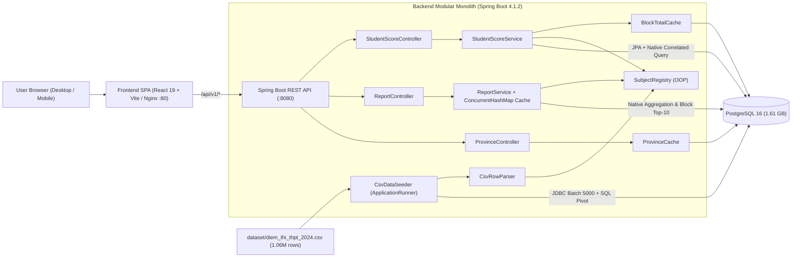

> **Metadata kiểm toán lịch sử (Historical Baseline Snapshot)**
> - **Ngày kiểm toán**: `2026-11-19`
> - **Baseline Commit**: `3744422` (`Refine mobile typography and disable chart hover on touch devices`)
> - **Tính chất tài liệu**: Báo cáo kiểm toán READ-ONLY ban đầu phản ánh nguyên trạng mã nguồn và cơ sở dữ liệu trước khi thực hiện các bản vá P0. Tài liệu này được lưu giữ nguyên bản làm hồ sơ lịch sử để theo dõi các phát hiện.

# G-SCORES — BÁO CÁO KIỂM TOÁN KỸ THUẬT CUỐI CÙNG (FINAL TECHNICAL AUDIT REPORT)

## 1. Tóm tắt điều hành (Executive Summary)

### Đánh giá tổng quan
Dự án **G-Scores** (React 19 + Spring Boot 4.1.2 + PostgreSQL 16 + Flyway + Docker) thể hiện nền tảng kỹ thuật vượt trội so với mặt bằng thực tập sinh: kiến trúc **Modular Monolith** rõ ràng theo feature, mô hình hóa OOP thực chất cho quản lý môn thi (`ExamSubject` / `ForeignLanguageSubject` / `SubjectRegistry`), cơ sở dữ liệu chuẩn hóa bảo toàn dữ liệu thưa (*sparse storage*) và độ chính xác thập phân (`NUMERIC`), cùng chiến lược tiền tính toán bảng điểm tổ hợp (`student_block_scores`) xử lý trơn tru hơn **1,06 triệu thí sinh** (6,03 triệu điểm môn, 2,62 triệu điểm khối).

Tuy nhiên, cuộc kiểm toán chuyên sâu (kết hợp phân tích mã nguồn tĩnh và truy vấn đọc-only kiểm chứng thực tế trên PostgreSQL chứa 1.061.605 thí sinh) đã phát hiện **một số lỗi nghiệp vụ, race condition khi khởi chạy Docker và sai lệch tài liệu nghiêm trọng** có thể khiến hội đồng chấm bài đánh giá thấp ngay ở bước dùng thử đầu tiên nếu không được khắc phục trước khi nộp.

### Mức độ sẵn sàng nộp bài
- **Chưa sẵn sàng nộp ngay** — Cần xử lý dứt điểm nhóm lỗi **P0** (lỗi ánh xạ sai tên 62/63 tỉnh thành [xác minh chi tiết sau đó: 57/63 tỉnh sai], race condition cache rỗng khi chạy Docker lần đầu, cập nhật chính xác `README.md` + Demo URL thật, bổ sung cấu hình SPA rewrite cho Vercel). Sau khi sửa các lỗi P0 này, bài làm sẽ đạt chất lượng rất cao.

### Thống kê trạng thái 14 yêu cầu chính thức (`FR`, `TR`, `NH`, `SR`)
| Trạng thái | Số lượng | Danh sách yêu cầu |
| :--- | :---: | :--- |
| **PASS** | **4** | `TR-01`, `TR-02`, `TR-04`, `SR-01` |
| **PARTIAL** | **8** | `FR-01`, `FR-02`, `FR-03`, `FR-04`, `TR-03`, `TR-05`, `NH-01`, `NH-02` |
| **FAIL** | **1** | `SR-02` |
| **NOT VERIFIED** | **1** | `NH-03` |

### Các rủi ro quan trọng nhất
1. **[HIGH] Ánh xạ sai tên tỉnh/thành phố** trong `backend/src/main/resources/db/migration/V3__add_provinces.sql#L10-L74` và `frontend/src/services/mockData.js#L1-L65` do nhầm thứ tự danh sách hành chính với **Mã Hội đồng thi của Bộ GD&ĐT** (ví dụ: mã `02` của **TP. Hồ Chí Minh** với 87.322 thí sinh bị hiển thị thành **"Hà Giang"**; Thủ khoa Khối A00 toàn quốc `26020938` ở **Thái Bình** bị hiển thị thành **"Ninh Bình"**).
2. **[HIGH] Race Condition khi khởi động Docker + Lỗi đóng băng Cache rỗng vĩnh viễn** giữa `docker-compose.yml#L43-L48`, `CsvDataSeeder.java#L48-L176` và `ReportService.java#L105-L148`: healthcheck `/api/v1/provinces` báo `healthy` ngay khi Flyway xong (trước khi Seeder nạp xong 1,06 triệu dòng); nếu người dùng mở web lúc đó, `ReportService` sẽ cache vĩnh viễn kết quả rỗng/thiếu.
3. **[HIGH] `README.md` mâu thuẫn nhiều điểm với mã nguồn thực tế** (`README.md#L1-L234`): ghi sai URL của 2/4 API chính, sai định dạng JSON response (ghi bọc `{code, message, data}` trong khi API trả phẳng), sai cấu trúc package, sai tên file migration V2, thiếu bảng biến môi trường và vẫn để placeholder Demo URL (`https://g-scores.example.com`).
4. **[HIGH] Rủi ro lỗi 404 khi F5 trên Vercel** do thiếu cấu hình SPA fallback (`vercel.json`) cho React Router `BrowserRouter`.
5. **[MEDIUM] Thiếu an toàn idempotency/transaction trong Seeder & độ phủ kiểm thử thấp**: `CsvDataSeeder` bỏ qua nạp lại nếu DB bị crash dở dang, có nguy cơ lỗi Foreign Key nếu CSV có SBD trùng, chưa chạy `ANALYZE` sau khi seed; toàn dự án chỉ có 4 unit test POJO ở Backend và 0 test ở Frontend.

---

## 2. Tổng quan dự án (Project Overview)

### Tech Stack thực tế (xác minh từ `backend/pom.xml` & `frontend/package.json`)
- **Backend**:
  - Spring Boot `4.1.2` (`spring-boot-starter-parent`), Java target `17` trong `backend/pom.xml#L8-L30` (Docker runtime dùng Eclipse Temurin JRE `21` Alpine).
  - Spring Web MVC, Spring Data JPA (Hibernate), Bean Validation (`jakarta.validation`), Spring Boot Actuator, Flyway + `flyway-database-postgresql`, PostgreSQL JDBC Driver, Lombok.
- **Frontend**:
  - React `19.3.1`, Vite `8.3.6` (cài đặt `8.3.8`), Tailwind CSS `4.3.5` (`@tailwindcss/vite`), React Router DOM `7.18.5`, Recharts `3.10.1`, Axios `1.21.1`, Lucide React `1.74.0`, ESLint `10.14.0`.
- **Database**: PostgreSQL `16-alpine` (Local Docker container `gscores-postgres` đang chứa dữ liệu thực tế `1.061.605` thí sinh).
- **Dataset**: `dataset/diem_thi_thpt_2024.csv` (42,1 MB, chính xác `1.061.606` dòng gồm 1 dòng header + `1.061.605` dòng thí sinh; thư mục `dataset/` nằm trong `.gitignore#L10`).
- **Containerization**: Multi-stage `backend/Dockerfile`, `frontend/Dockerfile` + `frontend/nginx.conf`, và `docker-compose.yml`.

### Cấu trúc thư mục thực tế (Package-by-Feature Modular Monolith)
- `backend/src/main/java/com/example/backend/`:
  - `common/`: Exception handling (`GlobalExceptionHandler`), `ApiErrorResponse`, `WebCorsConfig`.
  - `subject/`: Thiết kế OOP môn thi (`ExamSubject`, `StandardExamSubject`, `ForeignLanguageSubject`, `LanguageCode`, `ScoreTier`, `SubjectRegistry`, entity `Subject`, `SubjectRepository`).
  - `importer/`: `CsvDataSeeder` (`ApplicationRunner`), `CsvRowParser`, `ImporterProperties`, `ParsedStudentRow`.
  - `province/`: `Province`, `ProvinceRepository`, `ProvinceCache`, `ProvinceController`, `ProvinceResponse`.
  - `score/`: `ExamScore`, `ExamScoreRepository`.
  - `student/`: `Student`, `StudentRepository`, `StudentBlockScore`, `StudentBlockScoreRepository`, `BlockTotalCache`, `StudentScoreService`, `StudentScoreController`, DTOs.
  - `report/`: `ReportController`, `ReportService`, DTOs (`OverviewReportResponse`, `SubjectDistributionItem`, `GroupACandidateItem`).
- `backend/src/main/resources/db/migration/`: `V1__init_schema.sql`, `V2__seed_subjects.sql`, `V3__add_provinces.sql`, `V4__create_student_block_scores.sql`.
- `frontend/src/`: `pages/` (`Dashboard`, `ScoreLookup`, `Leaderboard`), `components/` (11 components), `hooks/` (`useReportData`, `useScoreLookup`), `services/` (`apiClient`, `gscoresService`, `mockData`).

### Sơ đồ kiến trúc hệ thống (Mermaid)

### Luồng thực thi chính của ứng dụng
1. **Khởi động & Nạp dữ liệu**: Flyway chạy `V1`–`V4` -> Spring Boot khởi động Tomcat `:8080` -> `CsvDataSeeder.run()` kiểm tra `COUNT(*) FROM students`: nếu trống thì stream đọc `diem_thi_thpt_2024.csv` bằng `BufferedReader`, parse từng dòng qua `CsvRowParser` + `ExamSubject.normalizeScore()`, batch insert 5.000 thí sinh/lượt qua `JdbcTemplate`, đồng bộ sequence, chạy SQL pivot tổng hợp bảng `student_block_scores`, sau đó làm mới `BlockTotalCache` và `ProvinceCache`.
2. **Tra cứu điểm (`FR-02`)**: `ScoreLookup.jsx` -> `useScoreLookup` -> `GET /api/v1/students/{sbd}/scores` -> `StudentScoreController` -> `StudentScoreService` -> 3 truy vấn DB (`findBySbd`, `findByStudentIdWithSubject`, `findBlockRanksByStudentId`) + O(1) lookup từ `BlockTotalCache` & `ProvinceCache`.
3. **Thống kê 4 mức & Top 10 Khối A (`FR-03`, `FR-04`)**: `Dashboard.jsx` / `Leaderboard.jsx` -> `useReportData` -> gọi song song 3 API (`/reports/overview`, `/reports/score-distribution`, `/reports/group-a/top-10`) + `/provinces` -> `ReportController` -> `ReportService` (có cache theo tỉnh `ALL` hoặc mã tỉnh) -> `ExamScoreRepository`.

---

## 3. Ma trận truy xuất yêu cầu (Requirement Traceability Matrix)

| Req ID | Yêu cầu gốc | Triển khai thực tế | Bằng chứng (File & Line) | Trạng thái | Phát hiện (Findings) | Khuyến nghị |
| :--- | :--- | :--- | :--- | :---: | :--- | :--- |
| **FR-01** | Import dữ liệu CSV ~1M dòng vào DB (migration/seeder, xử lý null, duplicate, hiệu năng) | Flyway `V1`–`V4` + `CsvDataSeeder` (`BufferedReader` + `JdbcTemplate.batchUpdate` 5.000 dòng) + `CsvRowParser` + SQL precompute `student_block_scores`. Đã xác minh local DB đủ `1.061.605` thí sinh, `6.037.435` điểm, `2.627.815` dòng khối. | `backend/src/main/resources/db/migration/V1__init_schema.sql#L5-L39`, `V3__add_provinces.sql#L10-L74`, `CsvDataSeeder.java#L48-L280`, `CsvRowParser.java#L34-L75` | **PARTIAL** | 1) Sai mã tỉnh trong `V3`. 2) `CsvDataSeeder` bỏ qua nếu lần trước crash giữa chừng (`COUNT(*) > 0`). 3) Duplicate SBD gây lỗi FK ở batch `exam_scores` do tự tăng `nextStudentId++`. 4) Không bọc transaction mỗi batch & thiếu `ANALYZE` sau seed. | Sửa đúng bảng mã 63 Hội đồng thi Bộ GD&ĐT; dùng bảng metadata hoặc kiểm tra/dedupe SBD & bọc `TransactionTemplate` theo batch; thêm cờ trạng thái seed + `ANALYZE`. |
| **FR-02** | Tra cứu điểm theo SBD (validation, không tồn tại, tối ưu truy vấn) | `ScoreLookup.jsx` -> `useScoreLookup` -> `GET /api/v1/students/{sbd}/scores` -> `StudentScoreService` -> `StudentRepository` (`0.78ms`) + `ExamScoreRepository` (`0.12ms`) + `StudentBlockScoreRepository` (`215.77ms`, Index-Only Scan). | `frontend/src/pages/ScoreLookup.jsx#L25-L98`, `useScoreLookup.js#L57-L151`, `StudentScoreController.java#L20-L28`, `StudentScoreService.java#L48-L106`, `BlockScoreTable.jsx#L15-L98` | **PARTIAL** | 1) Hiển thị sai tên tỉnh. 2) `BlockScoreTable` không có empty state cho `4.201` thí sinh không đủ 3 môn tổ hợp nào. 3) `useScoreLookup.js:124` tự tính lại tên môn Ngoại ngữ thay vì dùng `languageDisplayName` từ Backend. | Sửa dữ liệu bảng `provinces`; thêm thông báo rỗng khi `blockScores.length === 0`; dùng trực tiếp `studentData.languageDisplayName`. |
| **FR-03** | Thống kê 4 mức điểm theo từng môn (`>=8`, `6..8`, `4..6`, `<4`) và vẽ biểu đồ | `Dashboard.jsx` -> `useReportData` -> `GET /api/v1/reports/score-distribution` -> `ReportService` -> `ExamScoreRepository` -> `ScoreDistributionChart` (Recharts). Ranh giới `4.0/6.0/8.0` và xử lý `NULL` vs `0.00` chính xác 100%. | `ExamScoreRepository.java#L19-L48`, `ReportService.java#L71-L107`, `ScoreDistributionChart.jsx#L70-L220`, `useReportData.js#L25-L99` | **PARTIAL** | 1) Lỗi race condition cache rỗng vĩnh viễn tại `ReportService.java:105`. 2) Cold query toàn quốc mất `4.77s` (Seq Scan 6M dòng), không dùng index `idx_exam_scores_subject_score`. 3) `useReportData` gọi thừa `/reports/overview` (`481ms`/tỉnh) dù UI không dùng; fallback `cachedData || fetchedData` có thể hiển thị dữ liệu tỉnh cũ. 4) Lọc theo tỉnh hiện sai tên tỉnh. | Chặn cache kết quả rỗng & xóa cache sau khi seed; bỏ gọi `/reports/overview` khi không hiển thị; sửa stale fallback trong `useReportData`. |
| **FR-04** | Top 10 thí sinh Khối A (Toán, Lý, Hóa), tính tổng, sắp xếp, xử lý thiếu điểm & đồng hạng | `Leaderboard.jsx` -> `GET /api/v1/reports/group-a/top-10` -> `ReportService` (Competition Rank `1,2,2,4`) -> `ExamScoreRepository.findTop10GroupAFromBlockScores` (`18ms` toàn quốc, `9.9ms` theo tỉnh). Xác minh DB: `0` thí sinh thiếu môn lọt vào `A00`. | `V4__create_student_block_scores.sql#L55`, `ExamScoreRepository.java#L50-L73`, `ReportService.java#L110-L150`, `GroupALeaderboardTable.jsx#L110-L199` | **PARTIAL** | 1) Thủ khoa A00 (`26020938`, Thái Bình) và Á khoa (`26009943`, Thái Bình) bị hiển thị sai thành **"Ninh Bình"**, hạng 3 (`19016615`, Bắc Ninh) thành **"Hải Dương"**. 2) Hardcode magic ID `subject_id = 1, 4, 5`. 3) `ReportService.java:148` thiếu guard chống cache rỗng. | Sửa bảng `provinces`; thay `subject_id = 1, 4, 5` bằng join theo `subjects.code`; tách query có/không có `provinceCode`; thêm guard chống cache rỗng. |
| **TR-01** | Frontend (React Hooks, cấu trúc component, gọi API, xử lý lỗi) | React 19 + Hooks (`useState`, `useEffect`, `useMemo`, `useCallback`, custom hooks `useScoreLookup`, `useReportData`, `useIsTouchOrMobile`), Axios interceptor chuẩn hóa lỗi. Đã chạy `npm run lint` đạt **0 lỗi**. | `useScoreLookup.js#L1-L197`, `useReportData.js#L1-L132`, `apiClient.js#L1-L39`, `Dashboard.jsx#L1-L93` | **PASS** | Mã nguồn sạch, phân tách tốt. Nhược điểm nhỏ: còn dead code (`ScoreTierBadge.jsx`, `SAMPLE_SBD_LIST`), trang lỗi ở `Dashboard`/`Leaderboard` chưa nối nút "Thử lại" tới `refreshReports`. | Xóa dead code, thêm nút "Thử lại" khi API lỗi, sửa stale data fallback ở `useReportData.js:25`. |
| **TR-02** | Backend OOP quản lý môn học (đóng gói, trừu tượng, kế thừa, đa hình) | Lớp trừu tượng `ExamSubject`, lớp con `StandardExamSubject` và `ForeignLanguageSubject` override `formatDisplayName()`, enum `LanguageCode` & `ScoreTier`, `SubjectRegistry`. | `ExamSubject.java#L10-L44`, `ForeignLanguageSubject.java#L3-L19`, `SubjectRegistry.java#L11-L64` | **PASS** | Thiết kế OOP thực chất, được sử dụng trực tiếp trong `CsvRowParser`, `StudentScoreService`, `ReportService`. Lưu ý nhỏ: `ScoreTier` chỉ được gọi trong unit test (thống kê production dùng SQL cho hiệu năng — hợp lý); `ExamBlock` nêu trong README không tồn tại dạng class OOP. | Cập nhật README đúng với thiết kế thực tế. |
| **TR-03** | Validation & Logic (đầu vào, dữ liệu thiếu/sai, không chỉ tin client) | Validate SBD `^\d{8}$` ở cả Frontend, Controller (`@Pattern`), và Service (`SBD_PATTERN`); validate `province` ở `ReportController`. | `StudentScoreController.java#L23-L26`, `StudentScoreService.java#L51-L54`, `ReportController.java#L42-L49`, `GlobalExceptionHandler.java#L21-L42` | **PARTIAL** | 1) Sai logic nghiệp vụ ánh xạ tỉnh (`V3`). 2) `GlobalExceptionHandler` nuốt `NoResourceFoundException`/`HttpRequestMethodNotSupportedException` thành HTTP `500` và hardcode câu lỗi SBD cho mọi validation error. 3) `CsvRowParser` chưa validate định dạng SBD, mã tỉnh, mã ngoại ngữ. | Bổ sung handler cho `HandlerMethodValidationException`, `NoResourceFoundException`, `HttpRequestMethodNotSupportedException`; chuyển `validateProvince` vào `ReportService`; thêm validation chặt ở `CsvRowParser`. |
| **TR-04** | Sử dụng ORM (entity, repo, relationship, transaction, tránh N+1) | Spring Data JPA + Hibernate (`ddl-auto=validate`, `open-in-view=false`), `@ManyToOne(fetch = LAZY)`, `JOIN FETCH` tránh N+1, trả DTO `record` thay vì lộ entity, kết hợp JDBC batch cho 1M dòng. | `application.properties#L18-L19`, `ExamScore.java#L41-L50`, `ExamScoreRepository.java#L13-L14`, `StudentBlockScoreRepository.java#L12-L33` | **PASS** | Thực hành JPA/ORM rất chuẩn, không có N+1 query. Lưu ý nhỏ: `StudentBlockScore` mapping raw `Long studentId` thay vì `@ManyToOne` (chấp nhận được với bảng phẳng chỉ đọc). | Có thể bổ sung `@UniqueConstraint` metadata trong `StudentBlockScore` để đồng bộ với DDL `V4`. |
| **TR-05** | Database (schema, kiểu dữ liệu, constraint, index, hiệu năng) | PostgreSQL 16, 5 bảng nghiệp vụ (`students`, `subjects`, `exam_scores`, `provinces`, `student_block_scores`), `NUMERIC(4,2)`/`(5,2)`, `CHECK (0..10)`, `UNIQUE`, FK, composite index. | `V1__init_schema.sql#L5-L39`, `V3__add_provinces.sql#L5-L100`, `V4__create_student_block_scores.sql#L6-L74` | **PARTIAL** | 1) Sai dữ liệu seed tỉnh ở `V3`. 2) Dư thừa **107 MB** index (`idx_exam_scores_student_id` 66 MB trùng prefix `uq_exam_scores_student_subject`; `idx_block_score_student_id` 41 MB trùng prefix `uq_student_block`). 3) Index `idx_exam_scores_subject_score` (172 MB) không được planner dùng khi aggregate. Tổng DB `1.61 GB`. | Sửa bảng `provinces`; xóa 2 index dư thừa tiết kiệm 107 MB + tăng tốc seed; đánh giá lại `idx_exam_scores_subject_score`. |
| **NH-01** | Responsive UI (Desktop, Tablet, Mobile) | Tailwind mobile-first (`sm:`, `md:`, `lg:`), input 16px chống zoom iOS, thanh môn cuộn ngang, tắt Recharts Tooltip trên touch/mobile (`useIsTouchOrMobile`), `md:hover:` chống dính hover. | `MainLayout.jsx#L41-L136`, `SbdSearchForm.jsx#L44`, `ScoreDistributionChart.jsx#L15-L33`, `index.css#L24-L48` | **PARTIAL** | Code responsive rất chỉn chu qua kiểm tra tĩnh; tuy nhiên **chưa kiểm chứng trực quan trực tiếp trên trình duyệt** ở các viewport thật trong phiên audit read-only này. | Kiểm thử trực quan trên Chrome DevTools (375px, 768px, 1440px). |
| **NH-02** | Docker (Dockerfiles, Compose, network, env, tái lập) | Multi-stage `backend/Dockerfile`, `frontend/Dockerfile` + `nginx.conf`, `docker-compose.yml` 3 services + `gscores-network` + mount `./dataset:ro`. | `backend/Dockerfile#L1-L32`, `frontend/Dockerfile#L1-L31`, `frontend/nginx.conf#L1-L53`, `docker-compose.yml#L1-L73` | **PARTIAL** | 1) Healthcheck `/api/v1/provinces` gây race condition với `CsvDataSeeder` + `ReportService`. 2) `backend/Dockerfile` chạy quyền `root` và thiếu `exec` trong `ENTRYPOINT`. 3) Chưa kiểm chứng chạy thực tế `docker compose up --build`. | Đổi healthcheck sang endpoint readiness chỉ trả `200` khi seed xong; dùng `exec java` + non-root `USER`; test sạch `docker compose down -v && docker compose up --build`. |
| **NH-03** | Deployment (Production config, truy cập thực tế, kết nối BE/DB) | Có cấu hình `VITE_API_BASE_URL`, `CORS_ALLOWED_ORIGINS`, `DB_URL` qua env var. | `README.md#L225-L229`, `apiClient.js#L4`, `application.properties#L7-L39` | **NOT VERIFIED** | 1) Không có Demo URL thực tế trong repo (`https://g-scores.example.com` là placeholder). 2) Thiếu `frontend/vercel.json` để rewrite SPA routes (`/search`, `/reports`) trên Vercel (dẫn đến 404 khi F5). 3) Không thể xác minh kết nối production từ môi trường kiểm toán. | Thêm `frontend/vercel.json` SPA rewrite; cập nhật Live Demo URL thật vào `README.md` và xác minh gọi API + F5 trực tiếp. |
| **SR-01** | Source Code (Git remote, cấu trúc dễ hiểu) | Remote `https://github.com/minh0trang/g-scores.git`, commit lịch sử sạch, cấu trúc dễ hiểu. | `.gitignore#L1-L203`, git log `3744422` | **PASS** | Tồn tại một vài file thừa từ template (`backend/HELP.md`, `frontend/README.md`, `frontend/src/assets/hero.png`, `react.svg`, `vite.svg`) và nội dung lặp đôi trong `.gitignore`. | Dọn dẹp file thừa và xóa các dòng lặp trong `.gitignore`. |
| **SR-02** | README (Tổng quan, tính năng, tech stack, cài đặt, env vars, DB, import, Demo URL) | Có file `README.md` trình bày đẹp, có hướng dẫn Docker và local. | `README.md#L4-L234` | **FAIL** | Sai lệch nhiều chi tiết quan trọng so với code thực tế: sai endpoint (`/group-a-top10`, `/distribution`), sai format JSON response, sai cây package backend, sai tên file `V2__add_indexes.sql`, sai version Spring Boot (`3.4+` vs `4.1.2`), sai mã môn (`GIAO_DUC_CONG_DAN` vs `GDCD`), sai số khối (`10` vs `11`), sai claim "unlogged table" & "~1–2ms", thiếu bảng biến môi trường, placeholder Demo URL & broken link `LICENSE`. | Viết lại toàn bộ các mục sai lệch trong `README.md` bám sát 100% mã nguồn thực tế, thêm bảng Environment Variables và Demo URL thật. |

---

## 4. Kiểm toán chức năng (Functional Audit)

### 4.1. Nhập dữ liệu CSV (`FR-01`)
- **Đã xác minh trên DB local**: Tập tin `dataset/diem_thi_thpt_2024.csv` có chính xác `1.061.606` dòng (`1.061.605` thí sinh). Truy vấn đọc-only trên container `gscores-postgres` xác nhận nạp đủ **1.061.605** dòng `students`, **6.037.435** dòng `exam_scores`, **2.627.815** dòng `student_block_scores`. Điểm `0.00` thật được giữ nguyên (ví dụ: 1 điểm 0 môn Toán, 20 điểm 0 môn Ngữ văn, 59 điểm 0 môn Địa lí), ô trống không bị ép thành `0`.
- **Vấn đề phát hiện (phân tích tĩnh + xác minh DB)**:
  1. **Sai mã tỉnh/thành phố** (`V3__add_provinces.sql#L10-L74`): Nhầm danh sách hành chính với **Mã Hội đồng thi (Mã Sở GD&ĐT)** theo Công văn 1277/BGDĐT-QLCL. Bằng chứng thực tế từ `students`: mã `02` có **87.322 thí sinh** (TP. Hồ Chí Minh) nhưng bị gán thành `"Hà Giang"`; mã `03` có **25.530 thí sinh** (Hải Phòng) bị gán thành `"Cao Bằng"`; mã `26` có **22.580 thí sinh** (Thái Bình) bị gán thành `"Ninh Bình"`; mã `51` có **20.251 thí sinh** (An Giang) bị gán thành `"TP. Hồ Chí Minh"`.
  2. **Thiếu an toàn idempotency khi crash giữa chừng** (`CsvDataSeeder.java#L54-L63`): Chỉ kiểm tra `SELECT COUNT(*) FROM students > 0`. Nếu container bị tắt khi mới nạp được 200.000 dòng, lần khởi động sau sẽ coi như đã seed xong và bỏ qua vĩnh viễn.
  3. **Nguy cơ sập import khi gặp SBD trùng lặp** (`CsvDataSeeder.java#L118-L210`): Seeder tự gán `assignedStudentId = nextStudentId++`. Nếu CSV có 2 dòng trùng SBD, `INSERT INTO students ... ON CONFLICT (sbd) DO NOTHING` bỏ qua dòng sau, nhưng `INSERT INTO exam_scores` vẫn chèn `student_id = assignedStudentId` không tồn tại -> lỗi vi phạm khóa ngoại `fk_exam_scores_student` làm sập toàn bộ batch và thoát luôn tiến trình nạp (bắt tại `catch` dòng 173).
  4. **Không có Transaction ở `flushBatch` & thiếu `ANALYZE`**: `flushBatch()` gọi 2 lần `jdbcTemplate.batchUpdate` độc lập không bọc transaction; sau khi hoàn tất nạp 1 triệu dòng + 2,6 triệu dòng khối, Seeder không gọi `ANALYZE` để cập nhật planner statistics.
  5. **Validation CSV còn hở** (`CsvRowParser.java#L46-L73`): Không kiểm tra định dạng SBD (8 chữ số), không kiểm tra `provinceCode` tồn tại trong 63 mã hợp lệ, và không kiểm tra `languageCode` thuộc `N1..N7`.

### 4.2. Tra cứu điểm thí sinh (`FR-02`)
- **Luồng đã xác minh**: `SbdSearchForm` -> `useScoreLookup` -> `gscoresService.fetchStudentScoresBySbd` -> `GET /api/v1/students/{sbd}/scores` -> `StudentScoreController` -> `StudentScoreService`.
- **Điểm mạnh**: Validate SBD `^\d{8}$` đầy đủ 3 lớp (Frontend, Controller `@Pattern`, Service `SBD_PATTERN`); trả HTTP `400` khi sai định dạng và `404` khi không tìm thấy; hiển thị rõ môn thi, điểm từng môn, tên ngoại ngữ đa hình, và bảng xếp hạng tổ hợp toàn quốc/tỉnh từ một nguồn sự thật duy nhất (Backend `blocks[]`).
- **Vấn đề phát hiện**:
  - Tên tỉnh/thành phố (`provinceName`) và tiêu đề cột `Hạng tại {provinceName}` bị sai cho đa số các tỉnh.
  - Xác minh DB cho thấy có **4.201 thí sinh** không có bất kỳ tổ hợp 3 môn trọn vẹn nào trong 11 khối (`students_without_any_block = 4201`), nhưng `BlockScoreTable.jsx#L27-L96` không có trạng thái trống (empty state), tạo ra bảng chỉ có tiêu đề cột trống rỗng.
  - `useScoreLookup.js#L124` tự gọi `formatSubjectDisplayName(subject, languageCode)` từ `mockData.js` thay vì tận dụng `studentData.languageDisplayName` do `ForeignLanguageSubject` của Backend trả về.

### 4.3. Thống kê 4 mức điểm theo môn (`FR-03`)
- **Xác minh ranh giới toán học (đã chạy SQL kiểm chứng trên 6.037.435 bản ghi)**:
  - `>= 8.00` (bao gồm chính xác `8.00`: vd. Toán có `54.182` thí sinh đạt đúng `8.00` đều nằm ở `excellent`).
  - `>= 6.00 AND < 8.00` (bao gồm chính xác `6.00`: Toán có `40.255` thí sinh).
  - `>= 4.00 AND < 6.00` (bao gồm chính xác `4.00`: Toán có `16.457` thí sinh).
  - `< 4.00` (bao gồm `0.00` thật, loại trừ tuyệt đối môn không dự thi).
  - Tổng 4 mức của cả 9 môn khớp tuyệt đối 100% với tổng số thí sinh dự thi từng môn (vd. Toán: `198.392 + 505.836 + 258.654 + 82.731 = 1.045.613`).
- **Vấn đề phát hiện**:
  - Lỗi đóng băng cache rỗng/thiếu tại `ReportService.java#L105` khi có request đến trong lúc Seeder chưa chạy xong.
  - Truy vấn chưa cache tốn `4,77s` (toàn quốc) và `0,74s` (mã tỉnh `01`), cộng thêm `useReportData.js` gọi thừa `/api/v1/reports/overview` (tốn thêm `0,24s`–`0,48s`) dù không hề dùng dữ liệu `overview`.
  - Lỗi hiển thị nhầm dữ liệu cũ của tỉnh trước khi đổi tỉnh hoặc lỗi mạng do `const activeData = cachedData || fetchedData` tại `useReportData.js#L25`.

### 4.4. Top 10 thí sinh Khối A (`FR-04`)
- **Xác minh nghiệp vụ & DB**:
  - Khối A (`A00`) chỉ tính cho thí sinh có đủ cả 3 môn Toán, Vật lí, Hóa học (`0` bản ghi thiếu môn trong `343.800` thí sinh A00).
  - Tổng điểm làm tròn `ROUND(toan + ly + hoa, 2)`, lưu `NUMERIC(5,2)`.
  - Sắp xếp tất định (*deterministic*): `ORDER BY sbs.total_score DESC, s.sbd ASC LIMIT 10`. Hạng dùng **Competition Rank** (`1, 2, 2, 4`) nhất quán giữa Top 10 và hạng cá nhân.
- **Vấn đề phát hiện**:
  - Sai tên tỉnh hiển thị ngay trên Top 3 toàn quốc (`26020938` và `26009943` ở Thái Bình bị ghi là "Ninh Bình"; `19016615` ở Bắc Ninh bị ghi là "Hải Dương").
  - Hardcode `subject_id = 1, 4, 5` tại `ExamScoreRepository.java#L64-L66` phụ thuộc cứng vào thứ tự sinh ID của `V2__seed_subjects.sql`.
  - `ReportService.java#L148` thiếu điều kiện kiểm tra `!result.isEmpty()` trước khi cache.
  - Lưu ý nhỏ về nghiệp vụ mở rộng: Tổ hợp `D07` trong `StudentScoreService.java#L38` và `V4#L59` được gán là `Toán, Ngữ văn, Tiếng Hàn` (theo quy định Bộ GD&ĐT, `Toán - Văn - Hàn` là mã `DD2`, còn `D07` là `Toán - Hóa - Anh`).

---

## 5. Kiểm toán kỹ thuật (Technical Audit)

### 5.1. Kiến trúc & Backend
- **Ưu điểm**: Modular Monolith tách module theo domain rõ ràng; Controller mỏng, không lộ JPA Entity ra REST API (100% dùng Java `record` DTO); `@Transactional(readOnly = true)` đặt đúng ở tầng Service đọc dữ liệu; cấu hình `spring.jpa.open-in-view=false` và `spring.jpa.hibernate.ddl-auto=validate` đúng chuẩn Production.
- **Điểm cần cải thiện**:
  - `GlobalExceptionHandler.java#L21-L42`: Chưa xử lý `NoResourceFoundException` (404), `HttpRequestMethodNotSupportedException` (405), và `HandlerMethodValidationException` -> rơi vào `Exception.class` trả HTTP `500`. Hàm `handleValidationException` hardcode thông báo `"Số báo danh không hợp lệ..."` cho mọi lỗi validation.
  - `ReportController.java#L42-L56`: Đặt `validateProvince` / `normalizeProvince` trong Controller thay vì Service.
  - `BlockTotalCache.java#L27-L40` và `ProvinceCache.java#L33-L38`: Khi `refresh()` chạy `clear()` rồi mới `put()` vào `ConcurrentHashMap`, trong khoảnh khắc ngắn có thể gây đọc thấy map rỗng nếu có request đồng thời.

### 5.2. OOP (`TR-02`)
- **Đánh giá**: Đạt yêu cầu `TR-02` một cách thực chất thông qua `ExamSubject`, `StandardExamSubject`, `ForeignLanguageSubject` (đa hình `formatDisplayName`), `LanguageCode`, `ScoreTier`, và `SubjectRegistry`.

### 5.3. ORM & Thiết kế Database (`TR-04`, `TR-05`)
- **Ưu điểm**: Không có N+1 query; chính xác kiểu số (`NUMERIC(4,2)`, `NUMERIC(5,2)`), ràng buộc miền giá trị (`CHECK`), khóa ngoại, `UNIQUE` constraints chặt chẽ.
- **Vấn đề**: Dư thừa **107 MB** index (`idx_exam_scores_student_id` 66 MB trùng prefix `uq_exam_scores_student_subject`; `idx_block_score_student_id` 41 MB trùng prefix `uq_student_block`); `idx_exam_scores_subject_score` (172 MB) không được dùng khi aggregate.

### 5.4. Frontend & Tích hợp API (`TR-01`)
- **Ưu điểm**: Code gọn gàng, React Hooks đúng quy tắc (`npm run lint` = 0 lỗi/0 cảnh báo), khử trùng lặp request đồng thời (`inFlightRequests`), tối ưu mobile (input 16px, tắt tooltip trên touch).
- **Vấn đề**: Gọi thừa `/api/v1/reports/overview` ở `useReportData.js#L57`; lỗi `activeData = cachedData || fetchedData` tại `useReportData.js#L25`; chưa gắn nút "Thử lại" vào `refreshReports` ở màn hình lỗi; còn dead code (`ScoreTierBadge.jsx`, `SAMPLE_SBD_LIST`).

---

## 6. Kiểm toán bảo mật (Security Audit)

| Hạng mục | Kết quả kiểm tra | Bằng chứng | Mức độ | Khuyến nghị |
| :--- | :--- | :--- | :---: | :--- |
| **SQL Injection** | An toàn — 100% dùng Named Parameters hoặc JDBC `?` PreparedStatement. | `ExamScoreRepository.java`, `StudentBlockScoreRepository.java` | — | Duy trì kỷ luật hiện tại. |
| **Lộ Secret trong Git** | Không phát hiện mật khẩu cloud trong working tree hay toàn bộ git history. | Quét toàn bộ repo + `git log --all` | — | Xoay vòng mật khẩu Aiven nếu chuỗi kết nối đã từng lộ trong kênh ngoài. |
| **Mật khẩu mặc định** | `application.properties` & `docker-compose.yml` dùng fallback `gscores`/`gscores` cho local dev. | `application.properties#L8-L9`, `docker-compose.yml#L8-L9` | **LOW** | Ghi rõ trong `README.md` yêu cầu đặt mật khẩu mạnh khi deploy production. |
| **CORS Wildcard** | Hỗ trợ `CORS_ALLOWED_ORIGINS=*` qua `allowedOriginPatterns("*")`. | `WebCorsConfig.java#L17-L24` | **LOW** | Trên production đặt `CORS_ALLOWED_ORIGINS=https://<your-app>.vercel.app`. |
| **Spring Boot Actuator** | Chưa khóa cấu hình exposure tường minh trong `application.properties`. | `pom.xml#L34-L36`, `application.properties` | **LOW** | Khai báo `management.endpoints.web.exposure.include=health` và `show-details=never`. |
| **Container quyền `root`** | `backend/Dockerfile` thiếu non-root `USER` và `exec`. | `backend/Dockerfile#L18-L31` | **LOW** | Dùng non-root user + `exec java`. |

---

## 7. Kiểm toán hiệu năng (Performance Audit)

### 7.1. Hiệu năng đo đạc thực tế (Local PostgreSQL 16, 1.061.605 thí sinh)

| Truy vấn / Chức năng | Kế hoạch thực thi (Query Plan) | Thời gian đo thực tế | Đánh giá |
| :--- | :--- | :---: | :--- |
| `StudentRepository.findBySbd('01000001')` | `Index Scan using uq_students_sbd` | **0,78 ms** | Xuất sắc |
| `ExamScoreRepository.findByStudentIdWithSubject(1)` | `Index Scan` + `Hash Join` (9 môn) | **0,12 ms** | Xuất sắc |
| `StudentBlockScoreRepository.findBlockRanksByStudentId(1)` | `Index Scan` + 2× `Index Only Scan` (`Heap Fetches: 0`) | **215,77 ms** | Tốt, nhưng **không phải `~1–2ms`** như README tuyên bố |
| `findTop10GroupAFromBlockScores(NULL)` (Toàn quốc) | `Parallel Index Scan using idx_block_score_nat` + `Incremental Sort` | **18,01 ms** | Xuất sắc |
| `findTop10GroupAFromBlockScores('01')` (Tỉnh) | `Index Scan using idx_block_score_prov` + `Incremental Sort` | **9,88 ms** | Xuất sắc |
| `aggregateScoreDistributionBySubject()` (Toàn quốc, chưa cache) | `Seq Scan on exam_scores` (6.037.435 dòng) + `Hash Right Join` | **4.765,89 ms (~4,77 s)** | Điểm nghẽn cold-start |
| `aggregateScoreDistributionBySubjectAndProvince('01')` (chưa cache) | `Parallel Seq Scan on exam_scores` + `Parallel Hash Join` | **736,76 ms (~0,74 s)** | Chậm ở cold-start từng tỉnh |
| `COUNT(*) FROM exam_scores` (API `/overview` không dùng) | `Parallel Seq Scan on exam_scores` | **243,09 ms** | Lãng phí tài nguyên |
| `countByProvinceCode('01')` (API `/overview` không dùng) | `Parallel Seq Scan on exam_scores` + `Parallel Hash Join` | **481,28 ms** | Lãng phí tài nguyên mỗi lần đổi tỉnh |

### 7.2. Dung lượng lưu trữ thực tế
- `exam_scores`: **897 MB** (`347 MB` bảng + `550 MB` index).
- `student_block_scores`: **486 MB** (`151 MB` bảng + `335 MB` index).
- `students`: **229 MB** (`106 MB` bảng + `123 MB` index).
- **Tổng DB**: **~1,61 GB**.

---

## 8. Kiểm toán triển khai (Deployment Audit)
- **Docker**: Multi-stage build, `.dockerignore`, Nginx `try_files` + `/api/` reverse proxy đồng bộ với `VITE_API_BASE_URL=/api/v1`. Tuy nhiên healthcheck backend trỏ vào `/api/v1/provinces` gây race condition với `CsvDataSeeder` + `ReportService`; `node:20-alpine` nên ghim `node:20.19-alpine` hoặc `node:22-alpine` cho Vite `8.3.8`. Trạng thái `docker compose up --build`: **NOT VERIFIED** trong phiên audit read-only.
- **Production Deployment**: Thiếu `frontend/vercel.json` cho SPA rewrite; `README.md` chưa có Live Demo URL thật -> **NOT VERIFIED** tại thời điểm kiểm toán ban đầu.

---

## 9. Kiểm toán kiểm thử (Testing Audit)
- **Hiện có**: 4 unit test POJO trong `BackendApplicationTests.java` (chưa có Spring context/MockMvc/DB integration test); 0 test ở Frontend.
- **Thực thi read-only**: `npm run lint` đạt **PASS (0 errors)**; `./mvnw.cmd test` và `npm run build` chưa chạy lại trong phiên read-only (báo cáo Surefire gần nhất ghi `4/4 PASS`).

---

## 10. Tổng hợp phát hiện & Khuyến nghị (Findings)

- **F-01 [HIGH]**: Ánh xạ sai tên tỉnh/thành phố theo Mã Hội đồng thi Bộ GD&ĐT (`V3__add_provinces.sql#L10-L74`, `mockData.js#L1-L65`).
- **F-02 [HIGH]**: Startup Race Condition trên Docker + Cache rỗng vĩnh viễn trong `ReportService` (`docker-compose.yml#L43-L48`, `CsvDataSeeder.java#L48-L176`, `ReportService.java#L105-L148`).
- **F-03 [HIGH]**: `README.md` sai lệch nhiều chi tiết quan trọng với mã nguồn, thiếu bảng env vars, số liệu chưa trung thực, placeholder Demo URL (`README.md#L3-L234`).
- **F-04 [HIGH]**: Thiếu `frontend/vercel.json` gây 404 khi F5/truy cập trực tiếp sub-route trên Vercel (`App.jsx#L9-L17`).
- **F-05 [MEDIUM]**: Thiếu idempotency khi crash giữa chừng, rủi ro duplicate SBD, thiếu transaction batch, thiếu `ANALYZE`, và hở validation CSV (`CsvDataSeeder.java`, `CsvRowParser.java`).
- **F-06 [MEDIUM]**: Hardcode magic ID `subject_id = 1, 4, 5` trong SQL Top 10 Khối A (`ExamScoreRepository.java#L64-L69`).
- **F-07 [MEDIUM]**: Gọi thừa API `/api/v1/reports/overview` & rủi ro stale data fallback (`useReportData.js#L25-L65`).
- **F-08 [MEDIUM]**: Độ phủ kiểm thử tự động mỏng (4 unit test Backend, 0 test Frontend).
- **F-09 [MEDIUM]**: `GlobalExceptionHandler` nuốt lỗi 404/405 thành 500 & hardcode câu lỗi validation (`GlobalExceptionHandler.java#L21-L42`).
- **F-10 [MEDIUM]**: 107 MB index dư thừa + cold-start `4,77s` cho thống kê phân bố (`V1__init_schema.sql#L38-L39`, `V4#L73-L74`).
- **F-11 [LOW]**: Thiếu empty state trong `BlockScoreTable` & nút "Thử lại" ở `Dashboard`/`Leaderboard`.
- **F-12 [LOW]**: Dead code (`ScoreTierBadge.jsx`, `SAMPLE_SBD_LIST`), trùng lặp `.gitignore`, Dockerfile non-root/exec, `pom.xml` Java version.

---

## 11. Kế hoạch hành động (Action Plan) & Phán quyết ban đầu

- **P0 — Bắt buộc sửa trước khi nộp**: (1) Sửa đúng 63 mã tỉnh Bộ GD&ĐT (`V5`); (2) Xử lý Startup Race Condition, completeness metadata (`V6`) & cache safety; (3) Đồng bộ `README.md` + Demo URL thật; (4) Thêm `frontend/vercel.json`.
- **P1 — Khuyến nghị mạnh mẽ**: Bỏ gọi thừa `/overview` & sửa stale state trong `useReportData.js`; bỏ magic ID `subject_id = 1, 4, 5`; hoàn thiện `GlobalExceptionHandler`; bổ sung MockMvc/Service/Parser tests; gia cố `CsvDataSeeder` transaction/idempotency.
- **P2 — Cải tiến tùy chọn**: Drop 107 MB index dư thừa; dọn dead code, `.gitignore`, Dockerfile non-root `USER` + `exec`.

### Phán quyết tại thời điểm kiểm toán ban đầu
**`NOT READY — FIX REQUIRED ISSUES`** — Cần khắc phục trọn vẹn nhóm P0 trước khi nộp bài chính thức.

